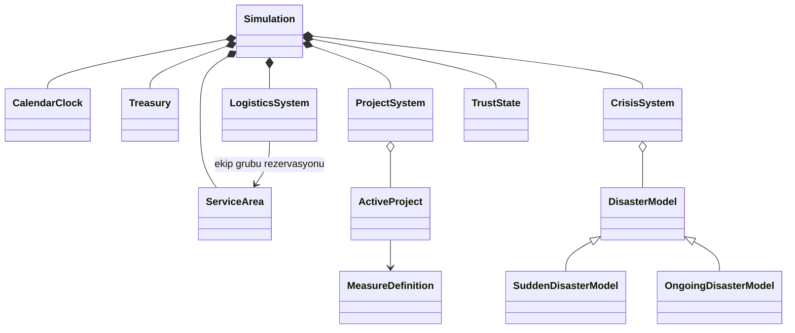

# Revert it — onaylanan oyun tasarımı

Karar tarihi: 17 Ekim 2026. Bu belge konuşmada seçilen davranışları toplar.
Sayısal ilk denge değerleri aşağıda ayrıca işaretlidir; henüz oynanış testi sonucu değildir.
İlk uygulama aşaması P0 arayüz ve asset üretimidir.

## Deneyim ve kapsam

Oyuncu tek ulusal hazineyi yöneten afet koordinatörüdür. Ana döngü hazırlık, yatırım,
afet sırasında kaynak paylaşımı ve sonuçlardan öğrenmedir.

- İlk beş dakikada temel mekanikler keşfedilir, bir yatırım tamamlanır ve en az bir afet görülür.
- 1950–2026 tam kampanyasında yaklaşık 30–45 dakika aktif oyun hedeflenir.
  Oyuncunun duraklayıp okuma/düşünme süresi bu hedefin dışındadır; hız seçimi süreyi değiştirir.
- Başlangıç yılı 1950–1990 arasında seçilir; başlangıç günü 1 Ocak'tır.
- Her kampanya 31 Aralık 2026 sonunda biter. Tarihsel mod oynanabilir, Sandbox kilitlidir.
- Başlangıç ekonomisi, temel araştırmalar ve altyapı seçilen döneme uygun hazırlanır.
- Kısa, atlanabilir ilk oyun rehberi şehir seçimi, yatırım, araştırma ve ilk afet sevkiyatını gösterir.
- Oyun ayrı ana menüden açılır. Yeni oyun, Tarihsel/Sandbox ve yıl seçimi yalnız bu akışta bulunur;
  harita, HUD ve şehir panelleri burada görünmez. Kampanya seçilmeden otomatik kayıt başlamaz.
- Oyun içi menü duraklatma ve ayarlar içindir; yeni kampanya seçimi içermez. Ana menüye dönmek
  mevcut kampanyayı kaydeder ve oyun ekranını kapatır. Menüden yeniden açılan kısa rehber ilk sayfaya döner.

## Harita ve yönetim alanları

Türkiye'nin tamamı başlangıçta görünür; yakınlaştırma ve sürükleme desteklenir.
Seçilen 21 ilin gerçek sınırları seçilebilirdir; kalan ülke daha soluk görünür.
Bir il aynı zamanda kendisine atanmış çevre illerin yönetim merkezidir.
Yerel yatırımlar bu sorumluluk alanına uygulanır. Tarihsel afetin gerçek yer adı korunur.

| Bölge             | Merkez iller                     |
| ----------------- | -------------------------------- |
| Marmara           | İstanbul, Kocaeli, Bursa         |
| Ege               | İzmir, Muğla, Manisa             |
| İç Anadolu        | Ankara, Konya, Eskişehir         |
| Akdeniz           | Antalya, Adana, Hatay            |
| Karadeniz         | Samsun, Trabzon, Rize            |
| Doğu Anadolu      | Erzurum, Van, Malatya            |
| Güneydoğu Anadolu | Gaziantep, Diyarbakır, Şanlıurfa |

Çevre iller, bölge içinde en yakın merkez esas alınarak 21 merkeze atanmıştır.
Bir il yalnız bir merkezin sorumluluğunda olur. Bölge/il/merkez kimlik ilişkileri doğrulanır.

Şehir panelinin ana değerleri merkez ilin tek başına verisi değildir: yönetilen nüfus,
alan geliri, altyapı direnci, afet türüne göre hazırlık ve lojistik durumu alanın bütününü anlatır.
Ayrı şehir güveni bulunmaz; güven tek ulusal skordur.

Haritanın dört katmanı Genel, Hazırlık, Lojistik ve Hasar/Toparlanma'dır.
Aktif afetler seçili katmandan bağımsız simgelerle de görünür.

## Görsel dil ve ana ekran

- Mantıksal viewport 1920×1080; harita ve UI bu ölçekte native pixel art olarak üretilir.
- Bütün görsellerin düzenlenebilir kaynağı Aseprite'tır. Raster AI görselleri üretim kaynağı değildir.
- Koyu lacivert/kömür grisi sivil kriz merkezi, kırmızı kriz vurguları, krem gazete kâğıdı.
- Harita, ekranı kaplayan kesintisiz arka plandır; HUD ve paneller bunun üzerinde açılır.
  Türkiye başlangıçta bütünüyle görünür; Balkanlar, Ege, Kafkasya ve yakın Orta Doğu soluk ülke sınırları
  ve ülke adlarıyla coğrafi bağlam sağlar. Yabancı ülke şehirleri, iç idari sınırları ve etkileşimi yoktur.
- Bütçe, ulusal güven ve bilinç puanı üst şeritte; tarih/hız/duraklatma aynı bölgede.
- Şehir seçilince solda sabit panel açılır. Yerel yatırımlar bu panelden başlatılır.
- Ulusal tedbirler ve araştırmalar üst menüden açılır; haber bandı altta, harita katmanları sağ alttadır.
- Tam ekran desteklenir. Seçim, hover, disabled, aktif ve klavye odağı görsel durumları hazırlanır.
- Renk, durum bilgisinin tek taşıyıcısı olmaz; simge ve metin de kullanılır.

## Ana menü ve kayıt

Oyun adı **Revert it**. Ana menü, gece afet koordinasyon odasını gösteren 1920×1080 native
pixel art splash kullanır. Türkiye panosu, telsiz, şehir ışıkları ve masa konsolları ayrı
Aseprite katmanlarıdır. Başlık ve düğmeler canlı UI'dır. Devam Et otomatik kaydı açar;
Yeni Oyun, Yükle, Ayarlar, Kısa Rehber ve Çıkış ayrı aksiyonlardır.

Bir otomatik ve üç manuel kayıt yuvası vardır. Manuel kayıt oyun içi menüden yapılır;
yükleme hem ana menüden hem oyun içinden yapılabilir. Yuva; oyun tarihi, başlangıç yılı
ve son yazılma zamanını gösterir. Boş/bozuk kayıtlar yüklemeye kapalıdır. Manuel kaydın
üzerine yazma ve oyun içinden kayıt yükleme onay ister. Yeni kampanya otomatik kaydı
değiştirir; üç manuel yuvaya dokunmaz. Sürüm 1 içerik doğrulaması ve güvenli dosya
yenilemesi korunur. Ayarlar tam ekran ve harita sarsıntısını yönetir.

## Kaynaklar ve ekonomi

Üç ana gösterge bütçe, ulusal güven ve harcanabilir bilinç puanıdır.
Bütçe oyunlaştırılmış TL tutarlarıyla gösterilir; gerçek tarihsel enflasyon hesaplanmaz.
Şehir/alan gelirleri nüfus ve ekonomik durumdan türetilip aylık ulusal hazineye girer.
Afet hasarı ilgili alanın gelirini azaltır; onarım ilerledikçe gelir ve altyapı toparlanır.

Tamamlanmış fiziksel tesis, altyapı ve ekiplerin aylık bakım gideri vardır.
Yönetmeliklerin ve bilinç geliştirmelerinin bakım gideri yoktur.
Aylık hesaplaşmada gelir eklenir, bakım karşılanır, sonra proje taksitleri değerlendirilir.
Bakımın yalnız bir kısmı karşılanırsa tesis ve ekipler karşılanan oranla düşük verimle çalışır;
bu durumda yeni proje taksitleri bekler. Bütçe eksiye indirilerek örtülü borç yaratılmaz.

Yatırımlar aylık taksitlerle ödenir. Oyuncu projeleri öncelikli işaretleyebilir;
eşit öncelikte eski başlayan önce ödenir. Ödenemeyen taksit o ay ilerleme sağlamaz.
Üst barda bakiye yanında aylık net akış, proje ekranında bakım ve taksit dökümü görünür.

## Projeler, araştırma ve tedbirler

- Her merkezde aynı anda bir yerel proje yürür. Onarım, ekip kurma ve stok hazırlama da bu slotu kullanır.
- Ayrı bir ulusal uygulama slotu vardır; tamamlanan ulusal tedbir bütün yönetim alanlarına taban koruma verir.
- Teknik araştırmalar ve bilinç geliştirmeleri ortak iki araştırma slotunu paylaşır.
  Ek bir araştırmayla kapasite artırılabilir.
- Teknik araştırmalar bütçe ve süre ister. Bilinç geliştirmeleri bilinç puanı ve daha kısa süre ister.
- Temel tedbirler baştan açıktır; gelişmiş tedbirler dönem kilidi ve araştırma önkoşulu taşır.
- Tamamlanmamış tedbir koruma sağlamaz. Aynı çapraz etki UI'da tekrar hesaplanmaz.
- Manuel duraklatma ilerlemeyi korur ve aktif slotu başka işe açar.
  Yeniden başlatırken kapasite tekrar kontrol edilir. İptalde ödenen taksitler iade edilmez.
- Tamamlama, ödeme ve etki uygulama aynı proje için yalnız bir kez gerçekleşir.

Araştırma ekranı bağlantılı ağaçtır. Sekmeler:

1. Altyapı ve Koruma.
2. Erken Uyarı ve Haberleşme.
3. Lojistik ve Müdahale.
4. Bilinç.

Sekme sayısı slot sayısı değildir. Düğümde dönem, önkoşul, bedel, süre ve bütün afet etkileri görünür.
Bir araştırma/tedbirin tek tanımı ve kimliği vardır; farklı afetlere faydası ayrı kopyalarla kurulmaz.

Tedbir kataloğunun tasarım örnekleri:

| Tedbir                               | Birincil fayda               | Çapraz fayda                              |
| ------------------------------------ | ---------------------------- | ----------------------------------------- |
| Dere yatağı imar düzeni              | Sel maruziyetini azaltma     | Uygun yerleşim/zeminle yapı koruması      |
| Sismik izolasyon ve güçlendirme      | Deprem yapı hasarını azaltma | İkincil yangın etkisini azaltma           |
| Yangın şeridi ve su rezervi          | Yangın yayılımını sınırlama  | Lojistik su hazırlığı                     |
| Mahalle tatbikatları ve afet çantası | Ortak toplumsal hazırlık     | Panik ve ilk müdahale gecikmesini azaltma |
| Erken gaz kesme otomasyonu           | Depremde altyapı güvenliği   | İkincil yangın etkisini azaltma           |

Kuraklık örneklerinin aktif afet olarak kullanılması, bu türün içerik kataloğuna eklenmesine bağlıdır.
Mevcut katalog deprem, sel, yangın, çığ ve heyelan içerir. Nihai katalog maliyet/etki değerleri veri işidir.

## Bilinç ve güven

Bilinç puanı haritadaki baloncuklardan, tatbikatlardan ve bazı olay kararlarından kazanılır.
Sakin dönemde en fazla üç toplanmamış baloncuk birikir; bunlar kaybolmaz.
Kriz sırasında veya duraklatılmış oyunda yeni baloncuk üretilmez.

Bilinç geliştirmeleri güven kaybını yavaşlatma, tahliye hazırlığı ve gönüllü koordinasyonu gibi
ulusal bonuslara harcanır; fiziksel bütçe yatırımlarının yerine geçmez.

Ulusal güven 0–100 aralığındadır. Zamanla yavaş azalır; tamamlanan tedbirler ve tatbikatlarla artar.
Afet etkisinde hazırlık, müdahale başarısı, gecikme ve karşılanan ihtiyaç oranı ağır basar.
Güven 0'a inerse erken yenilgi gerçekleşir. 2026'ya ulaşmak kampanyayı tamamlar;
ek zorunlu kazanma eşikleri yoktur. Hazırlık, müdahale ve toparlanma ayrı değerlendirilir.

## Zaman ve tarihsel olaylar

Tek takvim kullanılır. Normal zamanda aylar otomatik akar; afet başlangıcında oyun duraklar.
Oyuncu devam ettirince gün ölçeğinde otomatik akış başlar. Her iki durumda duraklatma ve 1×/2×/4× vardır.
Afet günleri de aynı takvimi ilerletir; ay değiştiğinde aylık gelir/gider yalnız bir kez uygulanır.
Sakin moda ancak aktif acil kriz kalmadığında dönülür; onarım normal zamanda sürebilir.

Tarih işlemlerinde motorun tarih/zaman API'si kullanılır. Ay uzunluğu ve artık yıl elle sabitlenmez.
Bir zaman adımı birden çok olay/takvim sınırı geçerse aradaki bütün kayıtlar sırayla işlenir.
Duraklatma simülasyon zamanını ve zaman kaynaklı kazanımları durdurur.

Afetler gerçek başlangıç tarihlerinde oluşur; çakışanlar aynı takvimde ayrı kriz kartlarıdır.
Aynı başlangıç ve aynı kararlar aynı sonucu üretir: hazırlık, şiddet, gecikme ve kaynaklar hesap girdileridir.
Gizli zar atışı kullanılmaz.

Mevcut kaynak `our-game/events/historical/events.json` içindeki 99 kayıttır.
Bu, bütün tarihsel afetlerin eksiksiz ve doğrulanmış listesi olduğu iddiası değildir.
Tarihsel kaynak doğrulaması ve kaynak bağlantıları içerik hazırlama aşamasında tamamlanır.
Seçenekli olayların JSON içerikleri ayrıca gelecektir; olay tarihleri rastgele yeniden atanmaz.

Mevcut `duration` alanı fiziksel saniye değil, oyun müdahale penceresi için düşünülmüştür.
Entegrasyonda açık birim taşıyan `response_window_days` alanına dönüştürülüp değerleri dengelenir.
Olayların tarihi, adı ve referans tarihsel verileri bu dönüşümle değiştirilmez.

Çalışan normalize veri, `our-game/events/data/historical/events.json` ve karşılık gelen
`schemas/events/historical/events.schema.json` sahibinde olur; iki ayrı çalışan katalog tutulmaz.
Kararlı olay kimlikleri, gerçek etkilenen il kimlikleri, afet türü, oyun şiddet profili ve
müdahale penceresi doğrulanır. `casualties` tarihsel referanstır; oyuncu sonucuna sabit yazılmaz.
P0 bu gameplay JSON'unu değiştirmez.

## Kriz ve lojistik

MVP'de üç müdahale kategorisi vardır:

1. Sınırlı arama-kurtarma ekipleri.
2. Çadır/gıda/tıbbi desteği temsil eden tek yardım stoğu türü.
3. Acil bütçe aktarımı.

Her merkezin ekipleri ve yardım stoğu ayrıdır. Başlangıç miktarları döneme uygundur.
Yeni ekip kurma ve stok hazırlama bütçe/süre isteyen yerel projelerdir.
Haritada sürükle-bırak ana etkileşimdir; kaynak/miktar seçip Sevk et düğmesiyle aynı komut verilebilir.

Yakın/orta/uzak yolculuk 1/2/3 gündür. Göndermeden önce kaynak, miktar, hedef, varış günü ve TL bedeli görülür.
Ekipler görevden sonra kaynağa dönüş yolculuğu yapar; varınca yeniden kullanılabilir.
İlk taşıma bedeli dönüşü kapsar. Yardım stoğu hedefte tüketilir.
Yoldaki veya görevdeki kaynaklar ikinci kez atanamaz.

Acil fon sahadaki ekip/yardım verimini ve sonraki onarımı sınırlı artırır.
Fon sınırsız koruma üretmez, gerekli ekip ve malzemenin yerine geçmez.
Müdahale penceresi afet türü ve şiddetine göre belirlenir; süre sonunda rapor üretilir.
Onarım oyuncunun başlattığı, yerel slot kullanan taksitli projedir.

## Gazete, haber bandı ve rapor

Her afetin ilk haberi gazete modalı olarak açılır; buradan kriz paneline geçilir.
Seçenekli tarihsel olaylar da gazetedir; seçim yapılana kadar takvim durur.
Birden fazla bekleyen modal sırayla gösterilir; yeni olaylar yutulmaz.
Haber bandı tamamlanan iş, sevkiyat, destek ve benzeri rutin gelişmeleri anlatır.

Sonuç ana özeti etkilenen, kurtarılan ve güvende olan insanları gösterir.
İsteğe bağlı ayrıntılar can kaybı verisini içerebilir. Kurtarılanlar etkilenenlerin alt kümesi olduğunda
bu sayılar bağımsız toplamlar gibi toplanmaz; etiketler kapsamlarını açıklar.
Altyapı durumu, onarım bedeli ve güven değişiminin nedenleri görünür.

Tedbir faydası aynı afetin koruyucu tedbir etkileri kaldırılmış model hesabıyla karşılaştırılır.
Afet ve gerçekleşen sevkiyat kararları karşılaştırmada aynı tutulur.
Önlenen hasar ve korunan insan sayıları açıkça **simülasyon tahmini** olarak etiketlenir.
Bu değerler tarihsel gerçeğe ilişkin kesin bir alternatif tarih iddiası değildir.
Çapraz etkili tekil katkılar toplam etkiyi aşacak şekilde üst üste sayılmaz.

## İlk denge tablosu

Onaylanan başlangıç profili 1950 için ₺20 milyon hazine, bakım sonrası/proje öncesi aylık +₺5 milyon
ve örnek ucuz yerel proje için toplam ₺6 milyon/6 aydır. Diğer satırlar ilk prototip adaylarıdır.

| Kalem                      | Başlangıç adayı                 | Süre / açıklama                                    |
| -------------------------- | ------------------------------- | -------------------------------------------------- |
| 1950 hazine                | ₺20 milyon                      | Onaylanan ilk deneme                               |
| 1950 brüt alan gelirleri   | ₺6 milyon/ay                    | Toplam bakım adayı ₺1 milyon/ay                    |
| 1950 net akış              | +₺5 milyon/ay                   | Bakım sonrası, proje taksitleri öncesi             |
| Temel yerel tedbir         | ₺6 milyon                       | 6 ay, aylık ₺1 milyon                              |
| Fiziksel koruma projesi    | ₺18 milyon                      | 12 ay; tamamlanınca bakım başlar                   |
| Teknik araştırma           | ₺12 milyon                      | 12 ay                                              |
| Bilinç geliştirmesi        | 15 bilinç puanı                 | 3 ay; teknik araştırmadan kısa                     |
| Ulusal uygulama            | ₺36 milyon                      | 18 ay                                              |
| Arama-kurtarma ekibi kurma | ₺4 milyon                       | 4 ay; ekip başına aylık bakım adayı ₺40 bin        |
| Yardım hazırlama           | ₺2 milyon / örnek stok partisi  | 2 ay; parti büyüklüğü alan kapasitesiyle ayarlanır |
| Kapasite araştırması       | 2 araştırma slotundan 3'e geçiş | İlk adayda bir kez +1; fiyatı testte ayarlanır     |

İlk tempo adayı 1× hızda sakin ay için 2 gerçek saniye, kriz günü için 1 gerçek saniyedir.
Yalnız tempo hesabında deprem/sel için 7, yangın için 10, çığ/heyelan için 5 günlük geçici pencereler
kullanıldığında mevcut 99 kaydın çakışmalarıyla 676 kriz günü ve 901,78 sakin ay eşdeğeri elde edilir:
yaklaşık 41,3 dakika. Bu **takvim hesabıdır, oynanış testi değildir**.
1958 başlangıcının ilk kayıtlı afetine kadar yaklaşık 69 sakin ay bulunması ilk beş dakika testinde kapsanır.

İlk oynanış testinde öğretici duraklamalar, kısa krizlerin okunabilirliği, fon bonus sınırı,
sevk ücretleri, gelir kaybı/onarım eğrisi, güven düşüşü ve bilinç üretim sıklığı birlikte ayarlanır.
1990 gibi geç başlangıçların ayrı dönem fixture'ları aynı kabul hedefleriyle doğrulanır.

## Sınıf ilişkileri ve kural sahipliği

Afet, tedbir ve müdahale ekibi farklı kavramlardır; deprem bir savunma birimi değildir.
Kalıtım, zaman içindeki davranışı gerçekten farklı afet modellerinde kullanılır.
Tedbir/araştırma başına boş sınıf açılmaz; tanım verisi ve çalışan proje durumu ayrılır.

| Sahip                  | Tek sorumluluk                                                                    |
| ---------------------- | --------------------------------------------------------------------------------- |
| `Simulation`           | Takvimde komut sırası, ortak durum ve sistem koordinasyonu                        |
| `CalendarClock`        | Tek UTC gün, ISO tarih doğrulaması ve ay sınırları; hız/duraklatma Simulation'da  |
| `Treasury`             | Gelir, bakım oranı ve borç oluşturmayan bütçe/BP harcaması                        |
| `ServiceArea`          | Merkez/çevre il üyeliği, nüfus/gelir/altyapı ve yerel stok/ekip durumu            |
| `ProjectSystem`        | Aktif/duraklamış proje, süre, slot, önkoşul, tamamlama ve tedbir etkileri         |
| `DisasterModel`        | Tür/şiddet/pencere, zamanla etki ve müdahale sonucu hesaplama                     |
| `SuddenDisasterModel`  | Deprem, çığ ve heyelan gibi başlangıç darbesi + kurtarma penceresi                |
| `OngoingDisasterModel` | Sel/yangın gibi müdahale boyunca sürebilen etki profili                           |
| `LogisticsSystem`      | Kaynak rezervasyonu, gidiş/görev/dönüş, stok tüketimi ve varışlar                 |
| `TrustState`           | Tek ulusal skorun nedenli değişimleri, sınırlar ve erken yenilgi                  |
| Rapor hesabı           | Aynı modelle gerçek/tedbirsiz eş hesap; UI'ya hazır sonuç                         |
| Kayıt sahibi           | Sürümlü kampanya ve dört yuva; saat/proje/sevkiyat/modal kuyruğu, güvenli yükleme |

UI yalnız komut ister ve hazır durumu gösterir. Para, koruma, hasar, varış veya güven formülü panelde
tekrarlanmaz. Sürükle-bırak ve düğme aynı sevk komutunu kullanır. Yeni sistem klasörleri ilk gerçek
dosyalarıyla açılır; bu sınıfların tamamı P0 için peşinen iskelet olarak kurulmaz.

## Uygulama sırası ve kabul

### P0 — native UI ve örnek verili önizleme

17 Ekim 2026: ana harita/panel dengesi ve yazı ölçeği kullanıcı tarafından onaylandı.
P0 incelemesinde ekranlar uygun bulundu. Şehir paneli başlangıçta kapalı olur;
21 yönetim merkezinden biri seçilince açılır, × veya Esc ile kapatılır.
Haritadaki diğer 60 ilin sınırları soluk çizilir; bu iller seçilemez.
Son görsel kararla harita çerçevesi kaldırılır. HUD, haber bandı, şehir paneli ve harita kontrolleri
3072×1728 native bölgesel tuvalin üzerinde yer alır; viewport 1920×1080 kalır.
Çevre ülkeler yalnız görsel bağlamdır; yönetim ve seçim 21 merkezle sınırlıdır.
Örnek verili ekranlar `our-game/ui_preview/` altında, native kaynak/export eşlemesi
`art/production/ui/p0/README.md` içinde bulunur. Kalan ekranlar aynı dille görsel incelemeye hazırdır.
Üç kişinin paralel çalışması için harita/kampanya, yönetim/araştırma ve kriz/lojistik modülleri
ayrılmıştır; dosya paylaşımı [çalışma rehberinde](team-workflow.md) tanımlıdır.

İlk görsel inceleme harita + üst şerit + açık sol şehir panelidir. Sonra aynı dil:

- Ana menü, Tarihsel/Sandbox seçimi, 1950–1990 yıl seçimi ve Devam et durumu.
- Şehir paneli, yerel proje ve lojistik kartları.
- Dört sekmeli araştırma ağacı, ortak slotlar ve ulusal uygulama ekranı.
- Gazete ve karar butonları, paralel kriz kartları ve sevk görünümü.
- Afet raporu, isteğe bağlı ayrıntılar ve 2026 performans ekranı.
- Ortak çerçeve, düğme durumları, bitmap yazı, simgeler, tooltip ve duraklatma bileşenleri.

Teslim native Aseprite kaynakları, 1080p önizlemeler ve Godot'ta örnek verili tıklanabilir ekranlardır.
P0 gerçek ekonomi/afet/kayıt mekaniklerini çalışıyormuş gibi sunmaz; önizleme örnek veri olarak işaretlenir.
Gerçek oyuncu kayıtları okunmaz/yazılmaz ve tarihsel JSON değişmez.

### P1 — veri ve saf simülasyon

21 yönetim alanı eşlemesi, tarihsel katalog normalizasyonu/şema, tek takvim, hazine/projeler,
araştırma ve tedbir etkileri. Sınır tipleri ve kimlik ilişkileri doğrulanır.
`npm run check:data`, saf model için `npm run test:unit` ve entegrasyon için `npm run verify` kullanılır.

### P2 — kriz döngüsü ve tamamlanabilir demo

Sevkiyat/görev/dönüş, paralel afetler, güven, onarım, gazete kararları, sonuç karşılaştırması,
rehber, tek otomatik kayıt ve 2026 bitişi entegre edilir. Gerçek mekanik çalışması bu aşamalardadır.
Sağlık ve iş makinesi gibi ayrı birimler, ayrı malzeme türleri ve oynanabilir Sandbox MVP dışındadır.

17 Ekim 2026 entegrasyonu: P1/P2 çekirdek döngüsü canlı UI'ya bağlandı. 21 merkez bütün 81 ili
tekil olarak yönetir. 30 tedbir tanımı; yerel, ulusal, teknik ve bilinç ayrımı; taksit/bakım/slot
kuralları modellerde çalışır. Tarihsel 99 afet gerçek tarihte gazete açar; paralel kriz, sınırlı
fon, ekip/stok rezervasyonu, dönüş, manuel onarım ve karşılaştırmalı rapor entegredir.
Sürüm 1 otomatik/manuel kayıtlar ve 1950–1990 başlangıcı / 2026 bitişi kullanılabilir.
Karar isteyen ek tarihsel olay JSON'ları henüz sağlanmadığından içerikleri üretilmedi.
İnsan sonuçları referans kayıp alanından kopyalanmaz; popülasyon, oyun şiddeti, hazırlık,
varış günü ve kaynaklarla hesaplanır. Sayısal maliyet/yarar/şiddet dengesi ilk adaydır.

Müdahale günleri deprem/sel 7, yangın 10, çığ/heyelan 5; şiddeti 7 ve üzerindekilere 2 gün eklenir.
Sevkiyatlar merkez koordinatlarından yaklaşık mesafeyle sınıflanır: 250 km altı 1 gün,
650 km altı 2 gün, sonrası 3 gün; aynı alandaki ekip/stok yerinde hemen göreve girer.
Bir ekip/gün sınıfı taşıma bedeli ₺100 bin, bir yardım birimi/gün sınıfı ₺2.500'dür;
lojistik geliştirmesi ücreti azaltır. İlk bedel ekip dönüşünü de kapsar.
Acil fon kriz başına ₺5 milyonla sınırlıdır; kaynak verimine en fazla %25, sonraki onarıma
en fazla %20 indirim sağlar. Araştırmanın onarım indirimi ayrıca en fazla %15'tir.
Bilinç baloncukları sakin dönemde iki ayda bir, en fazla üç adet birikir; her biri 5 BP verir.
Altı bilinç geliştirmesinin tamamı bitince yeni baloncuk üretimi durur; mevcut baloncuklar toplanabilir.
Ulusal güvenin aylık taban aşınması 0,015 puandır. Bunlar gerçek oynanışla ayarlanacak değerlerdir.

### İlk denge düzeltmeleri ve görsel geri bildirim

17 Ekim oynanış tanısında altı otomatik politika, kaynak/güven yenilemesi olmadan çalıştırıldı.
Önceki modelde yalnız ekip sevk ederek, yardım stoğu tükenmiş ve onarımlar yapılmamışken bile
yaklaşık 100 güvenle 2026'ya ulaşılabiliyordu. Kullanıcı hazırlık, yardım ve onarım eksiklerinin
ölçülü güven baskısı yaratmasını seçti; başlangıçtaki ₺20 milyon ve aylık +₺5 milyon profili korundu.

- Müdahale güveni; ortalama zamanında destek, başlangıç hazırlığı ve karşılanmayan ekip/yardım
  oranlarından birlikte hesaplanır. Tek kriz alanındaki değişim −3 ile +2 puan arasındadır.
- Onarılmamış altyapı, nüfusla ağırlıklandırılmış ulusal hasar oranına göre aylık güveni aşındırır:
  ortalama hasarın her puanı için 0,0015 güven. Bilinç bonusu taban aşınmayı azaltır;
  onarım baskısı hasar giderildikçe azalır.
- Tekrarlanabilir stok/ekip/onarım projeleri tamamlanınca düz güven ödülü vermez. Kalıcı tedbir
  ve araştırmanın tamamlama ödülleri korunur; müdahalede fiilen kullanılan kaynaklar sonuçta değerlendirilir.
- Rapor, gerçekleşen güven sınırlandırmasını gösterir; 100 sınırında uygulanmayan artışı yazmaz.
- Önlenen hasarın TL karşılığı, aynı afetin tedbirli/tedbirsiz fiziksel hasar farkını ortak onarım
  fiyatıyla değerler. Şehir gelirinden türetilmez. Başlangıç altyapısı da karşılaştırmaya dahildir.
- Ayın ilk gününde başlayan afet, o sınırda yeni bilinç baloncuğu üretmez.
- Afet başlangıcında harita 0,30 saniye ve en fazla 3 piksel sarsılır, kısa kırmızı vurgu gösterilir.
  HUD ve paneller sabittir. Menüde sarsıntı kapatılabilir; kırmızı vurgu korunur. Tercih ayrı
  `user://preferences.cfg` dosyasındadır, kampanya kaydının parçası değildir.

Aynı politikaların yeni modeldeki tanı sonuçları:

| Başlangıç | Aksiyonsuz            | Yalnız müdahale        | Hazırlık ve müdahale    |
| --------- | --------------------- | ---------------------- | ----------------------- |
| 1950      | 1976'da erken yenilgi | 2004'te erken yenilgi  | 2026, yaklaşık 84 güven |
| 1990      | 2008'de erken yenilgi | 2026, yaklaşık 3 güven | 2026, yaklaşık 93 güven |

Bu değerler oyuncu başarı oranı değildir; belirli otomatik politikaların tanısıdır.
Uzun dönemde para ve bilinç fazlası görüldü. Kullanıcı kararıyla bilinç ağacı bitince yeni baloncuk
üretimi durur. Ekonomi için sonraki ayarlar gerçek oynanışa göre yapılacak; insanın okuma/karar
süresini içeren ilk beş dakika kabulü henüz tamamlanmadı. İlk paylaşılabilir demo Windows x64
taşınabilir ZIP olarak hazırlanır.

Entegrasyonun otomatik tempo kontrolünde 1950–2026 akışı 2.619 aktif saniye (43 dakika 39 saniye)
sürdü. Bu kontrol haber okumayı ve yenilgi dengesini dışarıda tutar; insan oynanış testi değildir.
1950–1990 arasındaki 41 başlangıç yılının hepsinde ilk afetin 300 aktif saniyeden önce gelmesi
ayrıca denetlenir. Haber bandı son mesajlarla tamamlanma/varış haberlerini dönüşümlü gösterir.

### Doğrulama hedefleri

- 1920×1080 gerçek renderer görüntüsünde okunaklı pixel art; taşma ve üst üste etiket yok.
- Gerçek il şekline tıklama, solda alan paneli, zoom/pan, dört katman ve sekmelerin görsel kontrolü.
- Aynı girdiler aynı sonucu verir; yüksek hızda olay/ay atlanmaz; duraklatmada kazanım doğmaz.
- Bir taksit/varış/tamamlama iki kez işlenmez; yoldaki ekip tekrar gönderilemez.
- Yetersiz bütçe, öncelik, bakım oranı ve duraklatıp slotu yeniden kullanma senaryoları.
- Çakışan krizler, 1/2/3 günlük sevk ve dönüş, tüketilen stok, onarım ve gelir toparlanması.
- Kayıt/yükleme aynı durumu korur; bozuk/sürümü uyuşmayan veri güvenle reddedilir.
- İlk beş dakika ve 30–45 dakika hedefi gerçek oynanışta ayrıca ölçülür; şema/başarı kodu denge kanıtı değildir.
