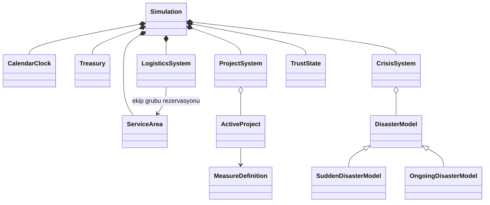

# Rewrite it — onaylanan oyun tasarımı

Karar tarihi: 17 Ekim 2026. Bu belge konuşmada seçilen davranışları toplar.
Sayısal ilk denge değerleri aşağıda ayrıca işaretlidir; henüz oynanış testi sonucu değildir.
İlk uygulama aşaması P0 arayüz ve asset üretimidir.

## Deneyim ve kapsam

Oyuncu tek ulusal hazineyi yöneten afet koordinatörüdür. Ana döngü hazırlık, yatırım,
afet sırasında kaynak paylaşımı ve sonuçlardan öğrenmedir.

- İlk beş dakikada temel mekanikler keşfedilir, bir yatırım tamamlanır ve en az bir afet görülür.
- 1950–2026 tam kampanyasında yaklaşık 30–50 dakika aktif oyun hedeflenir.
  Oyuncunun duraklayıp okuma/düşünme süresi bu hedefin dışındadır; hız seçimi süreyi değiştirir.
- Başlangıç yılı 1950–1990 arasında seçilir; başlangıç günü 1 Ocak'tır.
- Her kampanya 31 Aralık 2026 sonunda biter. Tarihsel mod oynanabilir, Sandbox kilitlidir.
- Başlangıç ekonomisi, temel araştırmalar ve altyapı seçilen döneme uygun hazırlanır.
- Her yeni kampanyada uygulamalı rehber başlar. Orta kapsamlı başlangıç eğitimi şehir, harita,
  yatırım, araştırma, ekip/yardım hazırlığı ve zaman yönetimini öğretir; bilinç, ilk afet,
  sevkiyat, rapor ve onarım dersleri uygun koşul oluştuğunda devam eder.
- Oyun Rehberi 12 bölümde hazırlık, müdahale ve toparlanmayı açıklar; konu listesi ve
  geri/ileri gezinmeyle menüden tekrar okunabilir. Okumak uygulamalı derslerin ilerlemesini değiştirmez.
- Oyun ayrı ana menüden açılır. Yeni oyun, Tarihsel/Sandbox ve yıl seçimi yalnız bu akışta bulunur;
  harita, HUD ve şehir panelleri burada görünmez. Kampanya seçilmeden otomatik kayıt başlamaz.
- Oyun içi menü duraklatma ve ayarlar içindir; yeni kampanya seçimi içermez. Ana menüye dönmek
  mevcut kampanyayı kaydeder ve oyun ekranını kapatır. Oyun Rehberi genel bakış sunar;
  oyun içinde buradaki Rehbere Devam Et, kampanyanın kalan uygulamalı derslerini açar.

## Uygulamalı rehber

Görev kartı yapılacak işlemi ve nedenini anlatır; ok ve çerçeve güncel hedefi gösterir.
Oyuncu diğer kontrolleri kullanabilir. Bilgi adımları Anladım ile, alıştırmalar gerçek başarılı
işlemle tamamlanır. Önceden yapılmış uygun işlem tekrar harcama gerektirmez. Yerel koruma,
teknik araştırma, ekip, yardım ve bilinç geliştirmesi ayrı alıştırmalardır.

Her yeni ders zamanı bir kez duraklatır; oyuncu kendi başlatır ve hızını kendi seçer.
Kriz haberi başlangıç alıştırmasını keser; gazete, ekip/yardım sevki ve rapor sonrası kalan
derslere dönülür. Baloncuk veya proje tamamlanmasını beklemek eğitimin geri kalanını kilitlemez.
Rehber dönem, slot ve kaynak uygunluğunu mevcut oyun modelinden okur. Taksitli projeye başlamak
gelecek ödemelerin garantisi değildir. Kaynak yoksa neden gösterilir; para, kaynak veya yapay
afet eklenmez. Karşılanmış ihtiyaca yeniden sevk yaptırılmaz.

Bu Adımı Atla yalnız dersi geçer; Rehberi Kapat ilerlemeyi korur. Menüden kalan dersler
sürdürülür; yapılan işlemler geri alınmaz. Rehber, oyuncu yerine gazete veya karar onaylamaz.
Ulusal önlem, proje kontrolleri, ikmal, acil bütçe, transfer, konuşlandırma/geri çağırma,
afet sonrası karar/taahhüt ve kondisyon/yenileme ilk bağlamlarında açıklanır. Bu ileri dersler
para harcamayı, taahhüt vermeyi veya proje iptalini zorunlu kılmaz.

## Harita ve yönetim alanları

Türkiye'nin tamamı başlangıçta görünür; yakınlaştırma ve sürükleme desteklenir.
Seçilen 21 ilin gerçek sınırları seçilebilirdir; kalan ülke daha soluk görünür.
Bir il aynı zamanda kendisine atanmış çevre illerin yönetim merkezidir.
Yerel yatırımlar bu sorumluluk alanına uygulanır. Tarihsel afetin gerçek yer adı korunur.

| Bölge             | Merkez iller                     |
| ----------------- | -------------------------------- |
| Marmara           | İstanbul, Kocaeli, Bursa         |
| Ege               | İzmir, Muğla, Manisa             |
| İç Anadolu        | Ankara, Konya, Eskişehir         |
| Akdeniz           | Antalya, Adana, Hatay            |
| Karadeniz         | Samsun, Trabzon, Rize            |
| Doğu Anadolu      | Erzurum, Van, Malatya            |
| Güneydoğu Anadolu | Gaziantep, Diyarbakır, Şanlıurfa |

Çevre iller, bölge içinde en yakın merkez esas alınarak 21 merkeze atanmıştır.
Bir il yalnız bir merkezin sorumluluğunda olur. Bölge/il/merkez kimlik ilişkileri doğrulanır.

Şehir panelinin ana değerleri merkez ilin tek başına verisi değildir: yönetilen nüfus,
alan geliri, altyapı direnci, afet türüne göre hazırlık ve lojistik durumu alanın bütününü anlatır.
Ayrı şehir güveni bulunmaz; güven tek ulusal skordur.

Haritanın dört katmanı Genel, Hazırlık, Lojistik ve Hasar/Toparlanma'dır.
Aktif afetler seçili katmandan bağımsız simgelerle de görünür.

## Görsel dil ve ana ekran

- Mantıksal viewport 1920×1080; harita ve UI bu ölçekte native pixel art olarak üretilir.
- Bütün görsellerin düzenlenebilir kaynağı Aseprite'tır. Raster AI görselleri üretim kaynağı değildir.
- Koyu lacivert/kömür grisi sivil kriz merkezi, kırmızı kriz vurguları, krem gazete kâğıdı.
- Harita, ekranı kaplayan kesintisiz arka plandır; HUD ve paneller bunun üzerinde açılır.
  Türkiye başlangıçta bütünüyle görünür; Balkanlar, Ege, Kafkasya ve yakın Orta Doğu soluk ülke sınırları
  ve ülke adlarıyla coğrafi bağlam sağlar. Yabancı ülke şehirleri, iç idari sınırları ve etkileşimi yoktur.
- Bütçe, ulusal güven ve bilinç puanı üst şeritte; tarih/hız/duraklatma aynı bölgede.
- Şehir seçilince solda sabit panel açılır. Yerel yatırımlar bu panelden başlatılır.
- Ulusal tedbirler ve araştırmalar üst menüden açılır; haber bandı altta, harita katmanları sağ alttadır.
- Tam ekran desteklenir. Seçim, hover, disabled, aktif ve klavye odağı görsel durumları hazırlanır.
- Renk, durum bilgisinin tek taşıyıcısı olmaz; simge ve metin de kullanılır.

## Ana menü ve kayıt

Oyun adı **Rewrite it**. Ana menü, gece afet koordinasyon odasını gösteren 1920×1080 native
pixel art splash kullanır. Türkiye panosu, telsiz, şehir ışıkları ve masa konsolları ayrı
Aseprite katmanlarıdır. Başlık ve düğmeler canlı UI'dır. Devam Et otomatik kaydı açar;
Yeni Oyun, Yükle, Ayarlar, Oyun Rehberi ve Çıkış ayrı aksiyonlardır.

Menü ve oyun ekranında demo etiketi, sabit bölge/merkez sayacı ve kayıt yuvası sayısı
gibi açıklama bantları gösterilmez. Metinler güncel durumu ve oyuncunun kararını destekler;
öğretici açıklamalar rehberde, simülasyon tahmini ve kayıt uyarıları ilgili ekranlarda kalır.

Bir otomatik ve üç manuel kayıt yuvası vardır. Manuel kayıt oyun içi menüden yapılır;
yükleme hem ana menüden hem oyun içinden yapılabilir. Yuva; oyun tarihi, başlangıç yılı
ve son yazılma zamanını gösterir. Boş/bozuk kayıtlar yüklemeye kapalıdır. Manuel kaydın
üzerine yazma ve oyun içinden kayıt yükleme onay ister. Yeni kampanya otomatik kaydı
değiştirir; üç manuel yuvaya dokunmaz. Sürüm 1 içerik doğrulaması ve güvenli dosya
yenilemesi korunur. Oyun ilk açılışta tam ekran başlar. Ayarlardan Tam Ekran,
Kenarlıksız veya Pencere seçilir; sonraki açılış son tercihi kullanır. F11 pencere ile
seçili tam ekran türü arasında geçer. Pencere modunun başlangıç ölçüsü 1600×900,
mantıksal UI ölçüsü 1920×1080'dir. Harita sarsıntısı ayrı ayardır.
Esc oyun içinde menüyü açar; tekrar Esc veya Devam Et önceki ekrana döndürür.
Takvim menü öncesi çalışıyorsa devam eder, zaten duraklatılmışsa durur.
Ayarlar/kayıt/yükleme/menüden açılan rehber ekranında Esc önce duraklatma menüsüne döner.
Okunmamış gazete ve raporlar bu geçişte korunur; ana menüde Esc oyunu kapatmaz.

## Kaynaklar ve ekonomi

Üç ana gösterge bütçe, ulusal güven ve harcanabilir bilinç puanıdır.
Bütçe oyunlaştırılmış TL tutarlarıyla gösterilir; gerçek tarihsel enflasyon hesaplanmaz.
Şehir/alan gelirleri nüfus ve ekonomik durumdan türetilip aylık ulusal hazineye girer.
Afet hasarı ilgili alanın gelirini azaltır; onarım ilerledikçe gelir ve altyapı toparlanır.

Tamamlanmış fiziksel tesis, altyapı ve ekiplerin aylık bakım gideri vardır.
Yönetmeliklerin ve bilinç geliştirmelerinin bakım gideri yoktur.
Aylık hesaplaşmada gelir eklenir, bakım karşılanır, sonra proje taksitleri değerlendirilir.
Bakımın yalnız bir kısmı karşılanırsa tesis ve ekipler karşılanan oranla düşük verimle çalışır;
bu durumda yeni proje taksitleri bekler. Bütçe eksiye indirilerek örtülü borç yaratılmaz.

Yatırımlar aylık taksitlerle ödenir. Oyuncu projeleri öncelikli işaretleyebilir;
eşit öncelikte eski başlayan önce ödenir. Ödenemeyen taksit o ay ilerleme sağlamaz.
Üst barda bakiye yanında aylık net akış, proje ekranında bakım ve taksit dökümü görünür.

## Projeler, araştırma ve tedbirler

- Her merkezde aynı anda bir yerel proje yürür. Onarım, ekip kurma ve stok hazırlama da bu slotu kullanır.
- Ayrı bir ulusal uygulama slotu vardır; tamamlanan ulusal tedbir bütün yönetim alanlarına taban koruma verir.
- Teknik araştırmalar ve bilinç geliştirmeleri ortak iki araştırma slotunu paylaşır.
  Ek bir araştırmayla kapasite artırılabilir.
- Teknik araştırmalar bütçe ve süre ister. Bilinç geliştirmeleri bilinç puanı ve daha kısa süre ister.
- Temel tedbirler baştan açıktır; gelişmiş tedbirler dönem kilidi ve araştırma önkoşulu taşır.
- Tamamlanmamış tedbir koruma sağlamaz. Aynı çapraz etki UI'da tekrar hesaplanmaz.
- Manuel duraklatma ilerlemeyi korur ve aktif slotu başka işe açar.
  Yeniden başlatırken kapasite tekrar kontrol edilir. İptalde ödenen taksitler iade edilmez.
- Tamamlama, ödeme ve etki uygulama aynı proje için yalnız bir kez gerçekleşir.

Üst menüde **Ekip ve Yardım Hazırla**, solda haritayı açık bırakan emir panelini açar.
Oyuncu **Ekip Kur** veya **Yardım Hazırla** seçtikten sonra yönetim merkezlerine tıklar;
her tıklama bir iş ekler, seçili eylem değişmez. Aynı merkeze tekrar tıklanabilir.
Şehirdeki yerel slot boşsa iş hemen başlar, doluysa şehir bazında eklenme sırasını bekler.
Farklı merkezler mevcut ortak hazineyle paralel çalışır. Ekip/yardım maliyeti, süre,
çıktı miktarı ve bakım dengesi değişmez. Sıradaki işler henüz ödeme yapmaz.
Bir iş aylık turda tamamlandığında sıradaki iş aktifleşir; aynı ay ikinci kez ödeme/ilerleme olmaz.
Panel stokları, çalışan işi, bekleyen ekip/yardım emir sayılarını ve ulusal proje taksitini gösterir.
Merkez satırındaki **−** son bekleyen emri ücretsiz kaldırır; başlamış işler Projeler'den yönetilir.
Duraklatılmış aynı tür iş sıra başını engelliyorsa açıklama gösterilir; devam veya iptal gerekir.
**Esc** emir verme modundan çıkıp duraklatma menüsünü açar; paneldeki **×** veya başka ekran açmak da emir verme modundan çıkarır.
Harita taşıma/yakınlaştırma sırasında emir eklenmez. Normal şehir paneli ve sevkiyat akışı korunur.

Araştırma ekranı bağlantılı ağaçtır. Sekmeler:

1. Altyapı ve Koruma.
2. Erken Uyarı ve Haberleşme.
3. Lojistik ve Müdahale.
4. Bilinç.

Sekme sayısı slot sayısı değildir. Düğümde dönem, önkoşul, bedel, süre ve bütün afet etkileri görünür.
Bir araştırma/tedbirin tek tanımı ve kimliği vardır; farklı afetlere faydası ayrı kopyalarla kurulmaz.

Tedbir kataloğunun tasarım örnekleri:

| Tedbir                               | Birincil fayda               | Çapraz fayda                              |
| ------------------------------------ | ---------------------------- | ----------------------------------------- |
| Dere yatağı imar düzeni              | Sel maruziyetini azaltma     | Uygun yerleşim/zeminle yapı koruması      |
| Sismik izolasyon ve güçlendirme      | Deprem yapı hasarını azaltma | İkincil yangın etkisini azaltma           |
| Yangın şeridi ve su rezervi          | Yangın yayılımını sınırlama  | Lojistik su hazırlığı                     |
| Mahalle tatbikatları ve afet çantası | Ortak toplumsal hazırlık     | Panik ve ilk müdahale gecikmesini azaltma |
| Erken gaz kesme otomasyonu           | Depremde altyapı güvenliği   | İkincil yangın etkisini azaltma           |

Kuraklık örneklerinin aktif afet olarak kullanılması, bu türün içerik kataloğuna eklenmesine bağlıdır.
Mevcut katalog deprem, sel, yangın, çığ ve heyelan içerir. Nihai katalog maliyet/etki değerleri veri işidir.

## Bilinç ve güven

Bilinç puanı haritadaki baloncuklardan, tatbikatlardan ve bazı olay kararlarından kazanılır.
Sakin dönemde en fazla üç toplanmamış baloncuk birikir; bunlar kaybolmaz.
Kriz sırasında veya duraklatılmış oyunda yeni baloncuk üretilmez.

Bilinç geliştirmeleri güven kaybını yavaşlatma, tahliye hazırlığı ve gönüllü koordinasyonu gibi
ulusal bonuslara harcanır; fiziksel bütçe yatırımlarının yerine geçmez.

Ulusal güven 0–100 aralığındadır. Zamanla yavaş azalır; tamamlanan tedbirler ve tatbikatlarla artar.
Afet etkisinde hazırlık, müdahale başarısı, gecikme ve karşılanan ihtiyaç oranı ağır basar.
Güven 0'a inerse erken yenilgi gerçekleşir. 2026'ya ulaşmak kampanyayı tamamlar;
ek zorunlu kazanma eşikleri yoktur. Hazırlık, müdahale ve toparlanma ayrı değerlendirilir.

## Zaman ve tarihsel olaylar

Tek takvim kullanılır. Normal zamanda aylar otomatik akar; afet başlangıcında oyun duraklar.
Aktif krizlerde her devam komutu bir oyun günü ilerletir ve takvim tekrar durur.
Her iki durumda duraklatma ve 1×/2×/4× vardır.
Afet günleri de aynı takvimi ilerletir; ay değiştiğinde aylık gelir/gider yalnız bir kez uygulanır.
Sakin moda ancak aktif acil kriz kalmadığında dönülür; onarım normal zamanda sürebilir.

Tarih işlemlerinde motorun tarih/zaman API'si kullanılır. Ay uzunluğu ve artık yıl elle sabitlenmez.
Bir zaman adımı birden çok olay/takvim sınırı geçerse aradaki bütün kayıtlar sırayla işlenir.
Duraklatma simülasyon zamanını ve zaman kaynaklı kazanımları durdurur.

Afetler gerçek başlangıç tarihlerinde oluşur; çakışanlar aynı takvimde ayrı kriz kartlarıdır.
Aynı başlangıç ve aynı kararlar aynı sonucu üretir: hazırlık, şiddet, gecikme ve kaynaklar hesap girdileridir.
Gizli zar atışı kullanılmaz.

Mevcut kaynak `our-game/events/historical/events.json` içindeki 99 kayıttır.
Bu, bütün tarihsel afetlerin eksiksiz ve doğrulanmış listesi olduğu iddiası değildir.
Tarihsel kaynak doğrulaması ve kaynak bağlantıları içerik hazırlama aşamasında tamamlanır.
Afet sonrası kararlar `events/data/decisions.json` içindeki 21 karttır. Son alan raporu
okunduktan sonra açılır; tarihsel karar tarihi bilgi olarak gösterilir. İliç maden kararı
ilk kapsamın dışındadır. Seçim kampanya boyunca kalıcıdır; ret normal proje ekranından
aşılamaz. Uygulama yerel/ulusal slotu paylaşır, dolu slotta sıraya girer. Anlık güven
sonucu seçimde, kalıcı fayda projenin tamamlanmasında uygulanır. Önizleme gerçek sayısal
farkı, toplam/taksit/bakım giderini ve süreyi gösterir.
Ayrıntılar ve sayısal ilk adaylar [karar rehberindedir](decision-events.md).

Mevcut `duration` alanı fiziksel saniye değil, oyun müdahale penceresi için düşünülmüştür.
Entegrasyonda açık birim taşıyan `response_window_days` alanına dönüştürülüp değerleri dengelenir.
Olayların tarihi, adı ve referans tarihsel verileri bu dönüşümle değiştirilmez.

Çalışan normalize veri, `our-game/events/data/historical/events.json` ve karşılık gelen
`schemas/events/historical/events.schema.json` sahibinde olur; iki ayrı çalışan katalog tutulmaz.
Kararlı olay kimlikleri, gerçek etkilenen il kimlikleri, afet türü, oyun şiddet profili ve
müdahale penceresi doğrulanır. `casualties` tarihsel referanstır; oyuncu sonucuna sabit yazılmaz.
P0 bu gameplay JSON'unu değiştirmez.

## Kriz ve lojistik

MVP'de üç müdahale kategorisi vardır:

1. Sınırlı arama-kurtarma ekipleri.
2. Çadır/gıda/tıbbi desteği temsil eden tek yardım stoğu türü.
3. Acil bütçe aktarımı.

Her merkezin ekipleri ve yardım stoğu ayrıdır. Başlangıç miktarları döneme uygundur.
Yeni ekip kurma ve stok hazırlama bütçe/süre isteyen yerel projelerdir.
Haritada sürükle-bırak ana etkileşimdir; kaynak/miktar seçip Gönderimi Onayla düğmesiyle aynı komut verilebilir.

Yakın/orta/uzak yolculuk 1/2/3 gündür. Göndermeden önce kaynak, miktar, hedef, varış günü ve TL bedeli görülür.
Ekipler görevden sonra kaynağa dönüş yolculuğu yapar; varınca yeniden kullanılabilir.
İlk taşıma bedeli dönüşü kapsar. Yardım stoğu hedefte tüketilir.
Yoldaki veya görevdeki kaynaklar ikinci kez atanamaz.

Acil fon sahadaki ekip/yardım verimini ve sonraki onarımı sınırlı artırır.
Fon sınırsız koruma üretmez, gerekli ekip ve malzemenin yerine geçmez.
Müdahale penceresi afet türü ve şiddetine göre belirlenir; süre sonunda rapor üretilir.
Onarım oyuncunun başlattığı, yerel slot kullanan taksitli projedir.

## Gazete, haber bandı ve rapor

Her afetin ilk haberi gazete modalı olarak açılır; buradan kriz paneline geçilir.
Seçenekli tarihsel olaylar da gazetedir; seçim yapılana kadar takvim durur.
Birden fazla bekleyen modal sırayla gösterilir; yeni olaylar yutulmaz.
Haber bandı tamamlanan iş, sevkiyat, destek ve benzeri rutin gelişmeleri anlatır.

Sonuç ana özeti etkilenen, kurtarılan ve güvende olan insanları gösterir.
İsteğe bağlı ayrıntılar can kaybı verisini içerebilir. Kurtarılanlar etkilenenlerin alt kümesi olduğunda
bu sayılar bağımsız toplamlar gibi toplanmaz; etiketler kapsamlarını açıklar.
Altyapı durumu, onarım bedeli ve güven değişiminin nedenleri görünür.

Tedbir faydası aynı afetin koruyucu tedbir etkileri kaldırılmış model hesabıyla karşılaştırılır.
Afet ve gerçekleşen sevkiyat kararları karşılaştırmada aynı tutulur.
Önlenen hasar ve korunan insan sayıları açıkça **simülasyon tahmini** olarak etiketlenir.
Bu değerler tarihsel gerçeğe ilişkin kesin bir alternatif tarih iddiası değildir.
Çapraz etkili tekil katkılar toplam etkiyi aşacak şekilde üst üste sayılmaz.

## İlk denge tablosu

### Kriz etkisi ve kolay sevk pilotu

Harita görünür kalırken sağ panelde sahadaki, zamanında yoldaki ve eksik destek
ayrılır. Kaynak merkez listesi varış süresi, sabit hızlı sevk bedeli ve merkez ID'siyle
sıralanır; elle seçilen kaynak korunur. Bir ekip ve on yardım düğmeleri görünen kaynak,
hedef ve bedelle doğrudan sevk eder. Eksik Kadar Seç yalnız miktarı doldurur; zamanında
yoldaki desteği çıkarır, seçilen kaynak kapasitesi ve bütçeyle sınırlanır.
Birden fazla kriz varsa şehirden geçişte hedef ayrıca seçilir. Düğmelerin devre dışı
kalma nedeni tooltip'te bulunur; normal form ve sürükle-bırak devam eder.

Rapor önce hazırlık faydasını, müdahale desteğini ve kalan hasarı açıklar.
Tek bir sevkiyata ayrı kurtarma katkısı atamaz; karşılaştırmalar simülasyon tahminidir.
Onarım tamamlanması bölge adıyla haber ve haritada geçici vurgu üretir.
İzole 1951 İskenderun pilotunda A harita/panel, B ek temsili saha sahnesidir.
Sahne bekleme, çalışma, yardım ve toparlanmayı model durumuna göre gösterir.
Normal kampanyada A kullanılır; B'nin genişletilmesi insan görsel/oynanış incelemesine bağlıdır.
Kabul: oyuncu yardımsız sevk yapabilmeli, bir kararının etkisini ve sonraki denemede
değiştireceği yaklaşımı anlatabilmelidir. Otomatik test bu insan kabulünün yerine geçmez.

Onaylanan başlangıç profili 1950 için ₺20 milyon hazine, bakım sonrası/proje öncesi aylık +₺3 milyon
ve örnek ucuz yerel proje için toplam ₺6 milyon/6 aydır. Diğer satırlar ilk prototip adaylarıdır.

| Kalem                      | Başlangıç adayı                 | Süre / açıklama                                    |
| -------------------------- | ------------------------------- | -------------------------------------------------- |
| 1950 hazine                | ₺20 milyon                      | Onaylanan ilk deneme                               |
| 1950 brüt alan gelirleri   | ₺4 milyon/ay                    | Toplam bakım adayı ₺1 milyon/ay                    |
| 1950 net akış              | +₺3 milyon/ay                   | Bakım sonrası, proje taksitleri öncesi             |
| Temel yerel tedbir         | ₺6 milyon                       | 6 ay, aylık ₺1 milyon                              |
| Fiziksel koruma projesi    | ₺18 milyon                      | 12 ay; tamamlanınca bakım başlar                   |
| Teknik araştırma           | ₺12 milyon                      | 12 ay                                              |
| Bilinç geliştirmesi        | 15 bilinç puanı                 | 3 ay; teknik araştırmadan kısa                     |
| Ulusal uygulama            | ₺36 milyon                      | 18 ay                                              |
| Arama-kurtarma ekibi kurma | ₺4 milyon                       | 4 ay; ekip başına aylık bakım adayı ₺40 bin        |
| Yardım hazırlama           | ₺2 milyon / örnek stok partisi  | 2 ay; parti büyüklüğü alan kapasitesiyle ayarlanır |
| Kapasite araştırması       | 2 araştırma slotundan 3'e geçiş | İlk adayda bir kez +1; fiyatı testte ayarlanır     |

Güncel tempo adayı 1× hızda sakin ay ve kriz günü için 1,5 gerçek saniyedir; 2×/4× korunur.
Krizde her günün sonunda takvim durur; yeniden başlatılınca yalnız sonraki gün ilerler.
Müdahale pencerelerine iki oyun günü eklenmiştir: çığ/heyelan 7, deprem/sel 9,
büyük deprem 11, orman yangını 12 gün sürer.
Kritik ikmal duruşları, gazete ve raporlar oyuncunun devam komutunu bekler. Aktif takvim hedefi
30–50 dakikadır; daha uzun müdahale pencereleri bu aralığa dahildir. İnsanın okuma ve düşünme süresi
bu hedefe eklenir.
1958 başlangıcının ilk kayıtlı afetine kadar yaklaşık 69 sakin ay bulunması ilk beş dakika testinde kapsanır.

İlk oynanış testinde öğretici duraklamalar, kısa krizlerin okunabilirliği, fon bonus sınırı,
sevk ücretleri, gelir kaybı/onarım eğrisi, güven düşüşü ve bilinç üretim sıklığı birlikte ayarlanır.
1990 gibi geç başlangıçların ayrı dönem fixture'ları aynı kabul hedefleriyle doğrulanır.

## Sınıf ilişkileri ve kural sahipliği

Afet, tedbir ve müdahale ekibi farklı kavramlardır; deprem bir savunma birimi değildir.
Kalıtım, zaman içindeki davranışı gerçekten farklı afet modellerinde kullanılır.
Tedbir/araştırma başına boş sınıf açılmaz; tanım verisi ve çalışan proje durumu ayrılır.

| Sahip                  | Tek sorumluluk                                                                    |
| ---------------------- | --------------------------------------------------------------------------------- |
| `Simulation`           | Takvimde komut sırası, ortak durum ve sistem koordinasyonu                        |
| `CalendarClock`        | Tek UTC gün, ISO tarih doğrulaması ve ay sınırları; hız/duraklatma Simulation'da  |
| `Treasury`             | Gelir, bakım oranı ve borç oluşturmayan bütçe/BP harcaması                        |
| `ServiceArea`          | Merkez/çevre il üyeliği, nüfus/gelir/altyapı ve yerel stok/ekip durumu            |
| `ProjectSystem`        | Aktif/duraklamış proje, süre, slot, önkoşul, tamamlama ve tedbir etkileri         |
| `DisasterModel`        | Tür/şiddet/pencere, zamanla etki ve müdahale sonucu hesaplama                     |
| `SuddenDisasterModel`  | Deprem, çığ ve heyelan gibi başlangıç darbesi + kurtarma penceresi                |
| `OngoingDisasterModel` | Sel/yangın gibi müdahale boyunca sürebilen etki profili                           |
| `LogisticsSystem`      | Kaynak rezervasyonu, gidiş/görev/dönüş, stok tüketimi ve varışlar                 |
| `TrustState`           | Tek ulusal skorun nedenli değişimleri, sınırlar ve erken yenilgi                  |
| Rapor hesabı           | Aynı modelle gerçek/tedbirsiz eş hesap; UI'ya hazır sonuç                         |
| Kayıt sahibi           | Sürümlü kampanya ve dört yuva; saat/proje/sevkiyat/modal kuyruğu, güvenli yükleme |

UI yalnız komut ister ve hazır durumu gösterir. Para, koruma, hasar, varış veya güven formülü panelde
tekrarlanmaz. Sürükle-bırak ve düğme aynı sevk komutunu kullanır. Yeni sistem klasörleri ilk gerçek
dosyalarıyla açılır; bu sınıfların tamamı P0 için peşinen iskelet olarak kurulmaz.

## Uygulama sırası ve kabul

### P0 — native UI ve örnek verili önizleme

17 Ekim 2026: ana harita/panel dengesi ve yazı ölçeği kullanıcı tarafından onaylandı.
P0 incelemesinde ekranlar uygun bulundu. Şehir paneli başlangıçta kapalı olur;
21 yönetim merkezinden biri seçilince açılır, × ile kapatılır. Esc duraklatma menüsünü açar.
Haritadaki diğer 60 ilin sınırları soluk çizilir; bu iller seçilemez.
Son görsel kararla harita çerçevesi kaldırılır. HUD, haber bandı, şehir paneli ve harita kontrolleri
3072×1728 native bölgesel tuvalin üzerinde yer alır; viewport 1920×1080 kalır.
Çevre ülkeler yalnız görsel bağlamdır; yönetim ve seçim 21 merkezle sınırlıdır.
Örnek verili ekranlar `our-game/ui_preview/` altında, native kaynak/export eşlemesi
`art/production/ui/p0/README.md` içinde bulunur. Kalan ekranlar aynı dille görsel incelemeye hazırdır.
Üç kişinin paralel çalışması için harita/kampanya, yönetim/araştırma ve kriz/lojistik modülleri
ayrılmıştır; dosya paylaşımı [çalışma rehberinde](team-workflow.md) tanımlıdır.

İlk görsel inceleme harita + üst şerit + açık sol şehir panelidir. Sonra aynı dil:

- Ana menü, Tarihsel/Sandbox seçimi, 1950–1990 yıl seçimi ve Devam et durumu.
- Şehir paneli, yerel proje ve lojistik kartları.
- Dört sekmeli araştırma ağacı, ortak slotlar ve ulusal uygulama ekranı.
- Gazete ve karar butonları, paralel kriz kartları ve sevk görünümü.
- Afet raporu, isteğe bağlı ayrıntılar ve 2026 performans ekranı.
- Ortak çerçeve, düğme durumları, bitmap yazı, simgeler, tooltip ve duraklatma bileşenleri.

Teslim native Aseprite kaynakları, 1080p önizlemeler ve Godot'ta örnek verili tıklanabilir ekranlardır.
P0 gerçek ekonomi/afet/kayıt mekaniklerini çalışıyormuş gibi sunmaz; önizleme örnek veri olarak işaretlenir.
Gerçek oyuncu kayıtları okunmaz/yazılmaz ve tarihsel JSON değişmez.

### P1 — veri ve saf simülasyon

21 yönetim alanı eşlemesi, tarihsel katalog normalizasyonu/şema, tek takvim, hazine/projeler,
araştırma ve tedbir etkileri. Sınır tipleri ve kimlik ilişkileri doğrulanır.
`npm run check:data`, saf model için `npm run test:unit` ve entegrasyon için `npm run verify` kullanılır.

### P2 — kriz döngüsü ve tamamlanabilir demo

Sevkiyat/görev/dönüş, paralel afetler, güven, onarım, gazete kararları, sonuç karşılaştırması,
rehber, bir otomatik / üç manuel kayıt ve 2026 bitişi entegre edilir. Gerçek mekanik çalışması bu aşamalardadır.
Sağlık ve iş makinesi gibi ayrı birimler, ayrı malzeme türleri ve oynanabilir Sandbox MVP dışındadır.

17 Ekim 2026 entegrasyonu: P1/P2 çekirdek döngüsü canlı UI'ya bağlandı. 21 merkez bütün 81 ili
tekil olarak yönetir. 30 tedbir tanımı; yerel, ulusal, teknik ve bilinç ayrımı; taksit/bakım/slot
kuralları modellerde çalışır. Tarihsel 99 afet gerçek tarihte gazete açar; paralel kriz, sınırlı
fon, ekip/stok rezervasyonu, dönüş, manuel onarım ve karşılaştırmalı rapor entegredir.
Sürüm 1 otomatik/manuel kayıtlar ve 1950–1990 başlangıcı / 2026 bitişi kullanılabilir.
Karar isteyen ek tarihsel olay JSON'ları henüz sağlanmadığından içerikleri üretilmedi.
İnsan sonuçları referans kayıp alanından kopyalanmaz; popülasyon, oyun şiddeti, hazırlık,
varış günü ve kaynaklarla hesaplanır. Sayısal maliyet/yarar/şiddet dengesi ilk adaydır.

Müdahale günleri deprem/sel 7, yangın 10, çığ/heyelan 5; şiddeti 7 ve üzerindekilere 2 gün eklenir.
Sevkiyatlar merkez koordinatlarından yaklaşık mesafeyle sınıflanır: 250 km altı 1 gün,
650 km altı 2 gün, sonrası 3 gün; aynı alandaki ekip/stok yerinde hemen göreve girer.
Bir ekip/gün sınıfı taşıma bedeli ₺100 bin, bir yardım birimi/gün sınıfı ₺2.500'dür;
lojistik geliştirmesi ücreti azaltır. İlk bedel ekip dönüşünü de kapsar.
Acil fon kriz başına ₺5 milyonla sınırlıdır; kaynak verimine en fazla %25, sonraki onarıma
en fazla %20 indirim sağlar. Araştırmanın onarım indirimi ayrıca en fazla %15'tir.
Bilinç baloncukları sakin dönemde iki ayda bir, en fazla üç adet birikir; her biri 5 Bilinç Puanı verir.
Altı bilinç geliştirmesinin tamamı bitince yeni baloncuk üretimi durur; mevcut baloncuklar toplanabilir.
Ulusal güvenin aylık taban aşınması 0,01 puandır. Bunlar gerçek oynanışla ayarlanacak değerlerdir.

### İlk denge düzeltmeleri ve görsel geri bildirim (17 Ekim tarihsel tanı)

17 Ekim oynanış tanısında altı otomatik politika, kaynak/güven yenilemesi olmadan çalıştırıldı.
Önceki modelde yalnız ekip sevk ederek, yardım stoğu tükenmiş ve onarımlar yapılmamışken bile
yaklaşık 100 güvenle 2026'ya ulaşılabiliyordu. Kullanıcı hazırlık, yardım ve onarım eksiklerinin
ölçülü güven baskısı yaratmasını seçti; başlangıçtaki ₺20 milyon ve aylık +₺5 milyon profili korundu.

- Müdahale güveni; ortalama zamanında destek, başlangıç hazırlığı ve karşılanmayan ekip/yardım
  oranlarından birlikte hesaplanır. Tek kriz alanındaki değişim −3 ile +2 puan arasındadır.
- Onarılmamış altyapı, nüfusla ağırlıklandırılmış ulusal hasar oranına göre aylık güveni aşındırır:
  ortalama hasarın her puanı için 0,0015 güven. Bilinç bonusu taban aşınmayı azaltır;
  onarım baskısı hasar giderildikçe azalır.
- Tekrarlanabilir stok/ekip/onarım projeleri tamamlanınca düz güven ödülü vermez. Kalıcı tedbir
  ve araştırmanın tamamlama ödülleri korunur; müdahalede fiilen kullanılan kaynaklar sonuçta değerlendirilir.
- Rapor, gerçekleşen güven sınırlandırmasını gösterir; 100 sınırında uygulanmayan artışı yazmaz.
- Önlenen hasarın TL karşılığı, aynı afetin tedbirli/tedbirsiz fiziksel hasar farkını ortak onarım
  fiyatıyla değerler. Şehir gelirinden türetilmez. Başlangıç altyapısı da karşılaştırmaya dahildir.
- Ayın ilk gününde başlayan afet, o sınırda yeni bilinç baloncuğu üretmez.
- Afet başlangıcında harita 0,30 saniye ve en fazla 3 piksel sarsılır, kısa kırmızı vurgu gösterilir.
  HUD ve paneller sabittir. Menüde sarsıntı kapatılabilir; kırmızı vurgu korunur. Tercih ayrı
  `user://preferences.cfg` dosyasındadır, kampanya kaydının parçası değildir.

17 Ekim güven düzeltmesinin, günlük ikmal eklenmeden önceki tanı sonuçları:

| Başlangıç | Aksiyonsuz            | Yalnız müdahale        | Hazırlık ve müdahale    |
| --------- | --------------------- | ---------------------- | ----------------------- |
| 1950      | 1976'da erken yenilgi | 2004'te erken yenilgi  | 2026, yaklaşık 84 güven |
| 1990      | 2008'de erken yenilgi | 2026, yaklaşık 3 güven | 2026, yaklaşık 93 güven |

Bu değerler oyuncu başarı oranı değildir; belirli otomatik politikaların tanısıdır.
Uzun dönemde para ve bilinç fazlası görüldü. Kullanıcı kararıyla bilinç ağacı bitince yeni baloncuk
üretimi durur. Ekonomi için sonraki ayarlar gerçek oynanışa göre yapılacak; insanın okuma/karar
süresini içeren ilk beş dakika kabulü henüz tamamlanmadı. İlk paylaşılabilir demo Windows x64
taşınabilir ZIP olarak hazırlanır.

Önceki müdahale pencereleriyle günlük ikmal tempo kontrolünde 1950–2026 akışı
2.542 aktif saniye (42 dakika 22 saniye)
sürdü. Bu kontrol haber okumayı ve yenilgi dengesini dışarıda tutar; insan oynanış testi değildir.
İki günlük uzatmayla ve her gün sonunda duruşla güncel ölçüm 2.784 aktif saniyedir
(46 dakika 24 saniye); aynı okuma ve denge sınırları geçerlidir.
1950–1990 arasındaki 41 başlangıç yılının hepsinde ilk afetin 300 aktif saniyeden önce gelmesi
ayrıca denetlenir. Haber bandı son mesajlarla tamamlanma/varış haberlerini dönüşümlü gösterir.

### Günlük ikmal ve kaynak baskısı

18 Ekim deneme profili başlangıç rezervini korur; gelirler aynı bölgesel oranlarla toplam
₺4 milyona indirilir. İki standart ₺1 milyon taksit sonrasında aylık ₺1 milyon operasyon payı
kalır; daha fazla eşzamanlı taahhüt rezervi tüketir. Onarım, stok hazırlama, teknik araştırma
ve mevcut 21 karar kartının projeleri aynı bütçe ve slotlar için yarışır.

Sakin dönemde oyuncu birkaç oyun ayında bir stok üretimini, yatırım sırasını ve ekip konumunu
gözden geçirir. Hazır ekip başka merkeze geçici konuşlandırılabilir; asıl üssü değişmez.
Görevden asıl üsse döner, hazır beklerken elle geri çağrılabilir. Yardım merkezler arasında
taşındığında hedef depoda kalır. Ekip taşıması yön başına ekip/gün ₺50 bin; kriz emri gidiş ve
asıl merkeze dönüşü birlikte öder. Yardım taşıması birim/gün ₺2.500'dür.

Afetin günlük yardım ihtiyacı `şiddet × 5`, saha kapasitesi üç günlük ihtiyaçtır. Bütün varışlar
günlük tüketimden önce işlenir; öngörülen kapasiteyi aşacak sevk emri reddedilir. Yardım
eksikliğinde o günün desteği orantılı azalır. Rapor ve güven günlük karşılanma ortalamasını
kullanır; son gün boşalan stok başarısızlık sayılmaz. Kalan yardım hedef depoya döner.
Önümüzdeki üç günde yoldaki partiler dahil açık varsa çalışan takvim durur. Aynı açık yeniden
duruş üretmez; yeterli ikmalden sonra ortaya çıkan yeni açık tekrar uyarır.

Bu değerler ilk deneme adaylarıdır. `tests/integration/balance_probe.gd`, 1950/1990 için
aksiyonsuz, yalnız ekip, hazırlık/ikmal ve aşırı taahhüt politikalarını oyuncu kaydına veya
durum yenilemesine başvurmadan karşılaştırır. Sonuçlar insan başarı oranı değildir.

18 Ekim sürüm 3 denemesi sekiz koşuyu tamamladı. Hazırlık/ikmal politikası ₺8 milyon rezerv
eşiği ve aylık netin en fazla %75'i kadar yeni taksit taahhüdü kullanır. Karar kartlarında
odaklı programı seçer; aksiyonsuz ve yalnız ekip politikaları programları reddeder.

| Başlangıç | Aksiyonsuz yenilgi | Yalnız ekip yenilgisi | Hazırlık/ikmal sonucu | Aşırı taahhütte en düşük hazine / bekleyen proje-ay |
| --------- | ------------------ | --------------------- | --------------------- | --------------------------------------------------- |
| 1950      | 1975               | 1996                  | 2026, 77,1 güven      | ₺0 / 19.924                                         |
| 1990      | 2008               | 2021                  | 2026, 99,5 güven      | ₺14 / 9.132                                         |

Hazırlık politikası iki başlangıçta da yaklaşık ₺341–345 milyonla biter; uzun dönem para
fazlası tamamen giderilmiş değildir. Yeni ikmal kararlarının hissi ve sonraki sayısal ayar
insan oynanışında değerlendirilmelidir. Bekleyen proje-ay, her ay bekleyen proje sayısının
toplamıdır; geçen takvim ayı veya oyuncunun bekleme süresi değildir.

### Doğrulama hedefleri

MVP'de kalan kabul işleri:

- İlk kez oynayan bir kişiyle 1950 başlangıcında ilk beş dakikayı ölçmek: şehir seçimi,
  ilk yatırım ve araştırma, ilk gazete ve bilinçli sevkiyat. Otomatik test bu insan ölçümü değildir.
- 1950 ve 1990 başlangıçlarını gerçek kararlarla sona kadar oynayıp güven baskısını,
  uzun vadeli para birikimini ve 30–50 dakika hedefini değerlendirmek; maliyetleri bu veriye göre ayarlamak.
- Yeni 21 kararın bütçe/slot tercihlerini insan oynanışında değerlendirmek; ilk sayısal
  adayları 1950 ve 1990 kampanyalarında ayarlamak. Otomatik etki doğrulaması denge kanıtı değildir.
- Taşınabilir Windows paketini geliştirme araçları kurulu olmayan ikinci bir cihazda açıp
  tam ekran, kayıt/yükleme ve ilk kriz akışını kontrol etmek.

Sandbox, ayrı sahra hastanesi/iş makinesi birimleri ve ayrı malzeme türleri MVP dışındadır.

- 1920×1080 gerçek renderer görüntüsünde okunaklı pixel art; taşma ve üst üste etiket yok.
- Gerçek il şekline tıklama, solda alan paneli, zoom/pan, dört katman ve sekmelerin görsel kontrolü.
- Aynı girdiler aynı sonucu verir; yüksek hızda olay/ay atlanmaz; duraklatmada kazanım doğmaz.
- Bir taksit/varış/tamamlama iki kez işlenmez; yoldaki ekip tekrar gönderilemez.
- Yetersiz bütçe, öncelik, bakım oranı ve duraklatıp slotu yeniden kullanma senaryoları.
- Çakışan krizler, 1/2/3 günlük sevk ve dönüş, tüketilen stok, onarım ve gelir toparlanması.
- Kayıt/yükleme aynı durumu korur; bozuk/sürümü uyuşmayan veri güvenle reddedilir.
- İlk beş dakika ve 30–50 dakika hedefi gerçek oynanışta ayrıca ölçülür; şema/başarı kodu denge kanıtı değildir.

## 18 Ekim 2026 arayüz dili kararı

Arayüz gündelik Türkçe kullanır: Halkın Güveni, Bilinç Puanı ve Yardım Malzemesi.
Oyuncuya görünen başlangıç ve sonuç metinlerinde kampanya yerine oyun denir.
Teknik yatırım/araştırma adları korunur ve listelerde kısa fayda açıklamasıyla sunulur.
Açıklamaların görünürlüğü satır yoğunluğundan önce gelir. Yeni menü adları ve sunum sahipliği
[mimari belgede](architecture.md#arayüz-metinleri-ve-açıklamalar) tanımlıdır.

### Uzun kampanyada bakım, yenileme ve güven (sürüm 4)

- Güven 70 başlar. Bütün proje tamamlama bonusları kaldırılmıştır; hazırlık, zamanında ekip ve
  günlük yardımın gerçek afet sonucu değerlendirilir. Her tarihsel afet tek ulusal değerlendirme
  alır; merkez sayısı güven cezasını çarpmaz. Merkez sonuçları maruz kalan nüfusla ağırlıklandırılır.
  İlk aday sınırlar normal olayda en fazla +0,8, büyük olayda +1,2, kayıpta −3 puandır.
- Güven her seviyede ayda 0,01 taban aşınır; bilinç araştırmalarının mevcut azaltımı uygulanır.
- Her merkez 100 üzerinden tek kondisyon taşır; tam bakımda ayda 0,25 puan kaybeder.
  Eksik bakım aşınmayı artırır. 75'te uyarı, 65'te kritik uyarı çıkar ve takvim durur.
  Ekip ve fiziksel tesis verimi kondisyonla 1,0'dan 0,5'e yavaşça iner. Araştırma ve düzenlemeler
  yaşlanmaz. Geçici konuşlandırma ekibin asıl üssündeki kondisyonu kullanır.
- Merkez yenilemesi 6 ay, bir yerel slot ve aylık taksit ister; bitince kondisyonu 100 yapar.
  Toplam bedel kurulu ekip ve yerel fiziksel tesis kurulum değerinin yarısıdır. Bedel başlangıçta
  sabitlenir. Yeni yatırım yapmak kondisyonu sıfırlamaz; yenileme afet hasarını onarmaz.
  Böylece yaklaşık 8–12 yılda bir kapasiteyi güncel tutma kararı oluşur.
- Hasar afet ve merkez bazında kaydedilir. Altı tam takvim ayı sonrasında kalan gerçek hasar
  ulusal nüfus payıyla aylık güven baskısı üretir. Onarım en eski hasardan düşer; gerçekten
  uygulanmış ihmal kaybının en fazla yarısını, onarılan pay oranında geri kazandırabilir.
  Yeni afet eski hasarın süresini sıfırlamaz; sıfır güven sınırında uygulanmamış kayıp iade edilmez.
- Sıradan reform reddi cezasızdır. Açık taahhüdün iptali bir kez −0,5 güven; ilerlemesiz 6 ay
  uyarı ve 12 aydan itibaren ayda −0,1 güven doğurur. Duraklatma/yükleme sayaç yenilemez.
- Bütçe hedefi dikkatli yönetimde 3–6 aylık olağan harcama rezervidir. Bu bir para tavanı değildir.
  Denge tanısı birikmiş nakdi de kullanabilen politikayla bakım, yenileme, taksit, yardım ve onarımı
  birlikte ölçer; otomatik politika sonuçları insanın zorluk deneyiminin kanıtı değildir.

## 18 Ekim 2026 araştırma ve ulusal önlem genişlemesi

Araştırma dört dalda 40 seçeneğe çıkar: Altyapı ve Koruma, Uyarı ve Haberleşme,
Lojistik ve Müdahale, Bilinç. Her dalda 1950/1970/1990/2005/2020 için iki araştırma
vardır. Tarihler dönem erişim kilididir; kesin icat veya Türkiye'de kuruluş tarihi değildir.
Her önkoşulun tamamlanması gerekir; dallar birbirini dışlamaz.

Araştırmalar küçük yöntem kazanımları sağlar. 15 normal ulusal uygulama daha güçlü
fiziksel/operasyonel faydalar için araştırmaları kullanır. Yapı denetimi, güvenli dönüşüm
ve diğer afet sonrası karar programları ayrıca korunur; normal listeye kopyalanmaz.
Tek ulusal slot ve iki ortak araştırma slotu korunur; Araştırma kurumu yalnız bir ek
araştırma slotu açar. Bakım/kondisyon ve güvenin son ortak denge kararı geçerlidir:
proje tamamlamak doğrudan güven kazandırmaz; fayda gerçek afet sonuçlarıyla değerlendirilir.

| Dönem | Teknik araştırma   | Bilinç geliştirmesi | Ulusal uygulama    | Ulusal aylık bakım |
| ----- | ------------------ | ------------------- | ------------------ | ------------------ |
| 1950  | ₺12 milyon / 12 ay | 15 puan / 3 ay      | ₺24 milyon / 12 ay | ₺60 bin            |
| 1970  | ₺16 milyon / 12 ay | 20 puan / 3 ay      | ₺36 milyon / 12 ay | ₺80 bin            |
| 1990  | ₺20 milyon / 15 ay | 25 puan / 4 ay      | ₺48 milyon / 15 ay | ₺100 bin           |
| 2005  | ₺24 milyon / 18 ay | 30 puan / 4 ay      | ₺60 milyon / 18 ay | ₺120 bin           |
| 2020  | ₺30 milyon / 18 ay | 35 puan / 6 ay      | ₺72 milyon / 18 ay | ₺150 bin           |

Araştırma bakım istemez. Geç başlangıçta başlangıç yılından en az 20 yıl eski teknik
araştırmalar önkoşulları uygunsa otomatik tamamlanır; bilinç geliştirmeleri otomatik
tamamlanmaz. Otomatik kazanım güven ödülü üretmez. Otomatik gaz kesme 1990 otomasyon
araştırmasını gerektirir. Katalog değişikliği için eski kayıt geçişi yapılmaz; dosyalar
silinmez veya otomatik dönüştürülmez.

Ağaçta tarih soldan sağa ilerler. Her kart kısa bir nedensel açıklama ve bağımsız
tarih/araştırma kilitlerini gösterir. Önkoşul okları yönlüdür; başka daldaki gereklilikler
kategori adıyla ilgili karta bağlanır. Ulusal önlemler yıllara göre gruplanır. Ayrıntıda
uzun açıklama, gerçek sayısal etki karşılaştırması ve açılan içerikler bulunur. Metinler
sevk maliyetini varış süresiyle, kurtarma verimini ekip üretimiyle veya koruyucu bakımı
afet hasarı onarımıyla karıştırmaz.

Bedel ve bonuslar başlangıç denge değerleridir; otomatik kontroller insan oynanış
kabulünün yerine geçmez.

Sürüm 4 tanısında sekiz politika koşusu, nakit veya güven sıfırlamadan tamamlandı. Dikkatli
politika, gelecekteki bakım/yenileme yükünü ve on iki aylık taksit akışını hesaba katar; olağan
giderlere göre 4,5 aylık tamponu koruyarak yeni işe karar verir. Geç dönem medyan rezervi
1950 başlangıcında 4,89 ay, 1990 başlangıcında 4,80 ay oldu. İki koşu da 2026 sonuna ulaştı,
bakım tam ödendi ve bütçe yüzünden proje taksiti beklemedi; bitiş güvenleri 78,51 ve 85,39.
Aksiyonsuz, yalnız ekip ve aşırı taahhüt politikaları iki başlangıçta da kaybetti. Bu sonuçlar
3–6 ay hedefinin bu politikayla erişilebilirliğini gösterir; insan zorluk kabulü değildir.
